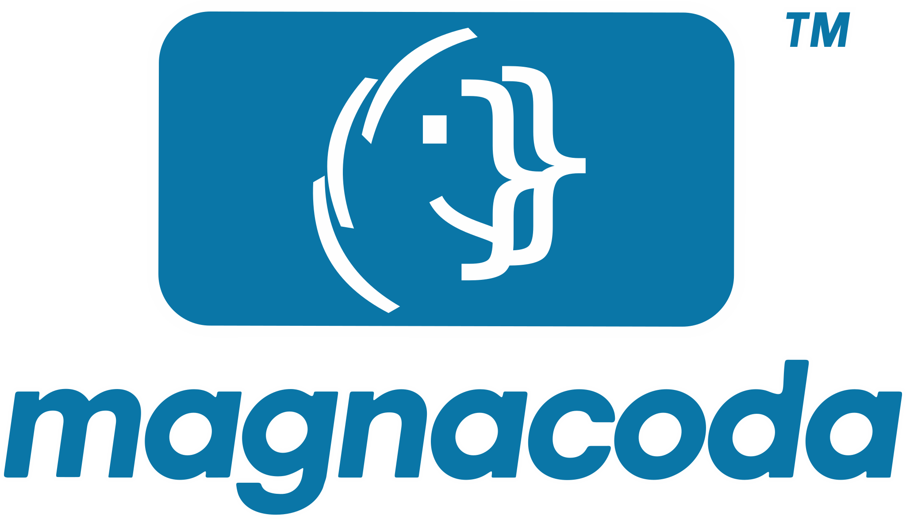

<h1 align="center">
<picture>
<source media="(prefers-color-scheme: dark)" srcset="docs/images/magnacoda-DrkColorGH-Logo.svg">

</picture>
</h1>
<p align="center">Scan for web accessibility issues.<br>Learn to fix them.</p>

**Contents**

- [Introducing *magnacoda*](#introducing-magnacoda)
  - [What is *magnacoda*?](#what-is-magnacoda)
  - [What can it do?](#what-can-it-do)
- [How do I get started?](#how-do-i-get-started)
  - [Requirements](#requirements)
  - [Quick start](#quick-start)
    - [With pipx instead](#with-pipx-instead)
  - [Guided wizard](#guided-wizard)
  - [Interactive shell](#interactive-shell)
  - [Help](#help)
  - [The manual](#the-manual)
- [About](#about)
  - [How this was built](#how-this-was-built)
  - [Credits and disclaimer](#credits-and-disclaimer)
  - [Contributing](#contributing)
  - [License: sustainable open source](#license-sustainable-open-source)
  - [About the name](#about-the-name)

## Introducing *magnacoda*

If you're new, start here to learn what *magnacoda*™ is, who it's for, and what it can do for your pages.

### What is *magnacoda*?

An accessibility (a11y) scanner for WCAG, the Web Content Accessibility Guidelines, that you run from your terminal. It scans web pages, including ones with dynamic, JavaScript-driven behavior such as single-page apps, lazy-loaded content and client-side routing.

*magnacoda* is built for developers and content managers who are comfortable in a terminal and want to understand and fix accessibility problems, not just list them. So it explains what it finds, suggests fixes, tests what automated rule checks cannot by browsing the page itself, and shows every criterion that must be evaluated by a person.

There are two ways to use *magnacoda*, human and machine:

- People use its interactive shell and guided wizard.
- Continuous integration (CI) pipelines, scripts and AI coding agents run it as a single command.

No automated tool can test all of WCAG. *magnacoda* lists every criterion in scope and shows which ones still need a person.

- *magnacoda*'s features range from detecting accessibility problems to offering solutions. See the next section, [What can it do?](#what-can-it-do)
- For what a scan covers and how to cover more, see [A note on coverage](docs/manual.md#a-note-on-coverage) (from the *magnacoda* shell, type `docs coverage`).
- See [Related tools](docs/manual.md#related-tools) for how it compares with others (from the *magnacoda* shell, type `docs related tools`).

*magnacoda is an independent project, not affiliated with the W3C or the WCAG working groups; see [Credits and disclaimer](#credits-and-disclaimer).*

### What can it do?

Below is an overview of *magnacoda*'s features, ranging from detecting accessibility problems to offering solutions:

- **Detection**: [axe-core](https://github.com/dequelabs/axe-core) is the bundled rule engine (it works offline), executed via [Playwright](https://playwright.dev/) in a headless browser so JavaScript-rendered content gets tested too.
- **Testing the page the way people use it**: *magnacoda* also presses `Tab` through the page, zooms it in and widens its text spacing, sends its forms empty, changes their fields, hovers, clicks and presses single keys. That covers parts of more than 20 WCAG criteria axe-core can't reach, such as focus you can't see, keyboard traps, sideways scrolling when zoomed in, and error messages screen readers aren't told about. No form is actually sent. See [Beyond axe-core](docs/manual.md#beyond-axe-core-testing-the-page-as-people-use-it) (from the *magnacoda* shell, type `docs beyond`).
- **Desktop and mobile, light and dark**: one scan covers a desktop screen and a phone (`--screen both`, the wizard's default) and marks problems seen on only one. Dark mode is checked on every scan, in seconds.
- **Review and recheck**: a saved scan opens in your browser with its pictures and a box to tick for every item, and once you've fixed something, a recheck tests just those problems again.
- **CI, scripts and AI agents**: one command with exit codes and JSON output, ready for GitLab CI or GitHub Actions, and for AI coding agents checking their own changes; see [How do I use it with CI, scripts and AI agents?](docs/manual.md#how-do-i-use-it-with-ci-scripts-and-ai-agents) (from the *magnacoda* shell, type `docs ci`). To see an agent and *magnacoda*'s AI work together on a page, see [A full example with an AI agent](docs/manual.md#a-full-example-with-an-ai-agent) (`docs full example`).
- **Optional AI**: three tiers (`off`, `explain`, `semantic`), using your own Anthropic API key or your Claude Code login. It's off by default and asks before sending anything.
- **Explanations**: the 10 most serious findings get a plain-language explanation; see [Top-10 ranking](docs/manual.md#top-10-ranking) (from the *magnacoda* shell, type `docs fix suggestions`).
- **Fix suggestions**: every finding gets one, from offline templates. With AI, the top 10 get a fix written for their context instead.

## How do I get started?

Check the [requirements](#requirements), install with the [quick start](#quick-start), then let the [guided wizard](#guided-wizard) walk you through your first scan. [Help](#help) and [the manual](#the-manual) are here when you need them.

### Requirements

- **Python 3.11 or newer.** You don't need to install it yourself if you use uv, as the quick start does, since uv brings its own.
- **One browser, not all of them: Chromium or Firefox.** *magnacoda* drives a browser build that Playwright downloads for you; it does not use the Chrome or Firefox already installed on your computer. `magnacoda setup` installs Chromium (about 100 MB), which is the default. To use Firefox instead, run `playwright install firefox` (about 110 MB) and add `--browser firefox` to your scans. You never need both.
- **Browser versions:** you don't choose them; they come with the Playwright release installed alongside *magnacoda*. *magnacoda* is tested with **Playwright 1.63 and 1.64**. A new install gets 1.64, which downloads **Chromium 156 and Firefox 157**.

### Quick start

**First, open a terminal**, the window where you type commands:

- **Windows:** open Start, type `Terminal` (on Windows 10, `PowerShell`) and press `Enter`.
- **macOS:** press `Cmd+Space`, type `Terminal` and press `Enter`.
- **Linux:** press `Ctrl+Alt+T` (on Ubuntu and many others), or find Terminal in your app menu.

The recommended way to install is [uv](https://docs.astral.sh/uv/), a fast installer for Python tools. It brings its own Python, so you don't need to install Python first, and it puts the `magnacoda` command on your PATH, with no virtual environment to set up or activate.

**Install uv** (once), then open a new terminal window so it finds the `uv` command:

- **Linux and macOS:** `curl -LsSf https://astral.sh/uv/install.sh | sh` (on macOS, `brew install uv` works too).
- **Windows:** `winget install astral-sh.uv`. If you don't have winget (some older Windows 10 installations), uv's own installer does the same: `powershell -ExecutionPolicy ByPass -c "irm https://astral.sh/uv/install.ps1 | iex"`.

**Install *magnacoda*,** then run your first scan:

```bash
uv tool install magnacoda
magnacoda setup             # one-time: downloads the Chromium browser (~100 MB), and shows how the AI tiers will run
magnacoda wizard            # a few questions, then it runs the scan for you (the first setup offers to start it)
magnacoda scan example.com  # or scan a page straight away; https:// is filled in for you (see URL rules)
```

**Next time,** open a terminal and type `magnacoda` to start the [shell](#interactive-shell), or `magnacoda wizard` to go straight to the [guided wizard](#guided-wizard). For more, including what to do if your terminal doesn't find `magnacoda`, see [Starting *magnacoda*](docs/manual.md#starting-magnacoda) (from the *magnacoda* shell, type `docs starting`).

#### With pipx instead

If you already use [pipx](https://pipx.pypa.io/), it works just as well. It uses a Python already on your computer, which must be 3.11 or newer (Ubuntu 22.04's is 3.10, too old; uv avoids this). Get pipx from your system's own installer rather than with pip, which recent Linux versions block:

- **Ubuntu and Debian:** `sudo apt install pipx`
- **Fedora:** `sudo dnf install pipx`
- **macOS:** `brew install pipx`, with [Homebrew](https://brew.sh/)
- **Windows:** install Python first, from [python.org](https://www.python.org/downloads/windows/) or with `winget install Python.Python.3.12`, then `py -m pip install --user pipx`. Avoid the Microsoft Store version of Python, because it quietly redirects some of the folders *magnacoda* uses and makes its settings and browser hard to find.

Then run `pipx ensurepath` (on Windows, `py -m pipx ensurepath`), open a new terminal window, and install:

```bash
pipx install magnacoda
magnacoda setup
```

**Installing from a downloaded copy of the code** (a zip or a clone, for example to try a version that isn't released yet):

- **Where to put it:** a short folder outside OneDrive, such as `C:\dev\magnacoda`.
  - OneDrive syncs Documents and Desktop, and syncing can lock files while the install runs.
  - Windows 10 limits most paths to 260 characters, and the install creates deep folders, so a short starting point helps.
  - Avoid Program Files, which needs administrator rights. Creating `C:\dev` doesn't.
- **Check the folder:** the path you give pipx or uv must be the folder that directly contains `pyproject.toml`, such as `C:\dev\magnacoda`. Unzipping often creates a doubled folder, `C:\dev\magnacoda\magnacoda`; if so, move everything from the inner folder up into the outer one, then delete the empty inner folder.
- **Install it** by giving the folder's full path. It doesn't matter which folder your terminal is in, since the installer goes by the path you give. Use one of these two, depending on whether you use uv or pipx (install that first, as shown above):
  - With uv: `uv tool install C:\dev\magnacoda`
  - With pipx: `pipx install C:\dev\magnacoda`

  Then, either way, run `magnacoda setup` once to download the browser.

  An add-on you've downloaded the same way goes into the same install:
  - With uv: `uv tool install C:\dev\magnacoda --with C:\dev\example-addon` (the install command again, with the add-on added; uv rebuilds the install to include it)
  - With pipx: `pipx inject magnacoda C:\dev\example-addon`

  To learn what add-ons are and how they show up in *magnacoda*, type `help add-ons`. To write your own, see [Writing an add-on](CONTRIBUTING.md#writing-an-add-on).
- **Keep the folder** if you may want to reinstall from it later. The installer copies everything it needs, so *magnacoda* doesn't run from it.

**If Windows says a command is not recognized:**

- **`magnacoda`, `pipx` or `uv`:** open a new terminal window. A newly installed command is only found in windows opened after it was installed (for pipx, after `py -m pipx ensurepath`).
- **`pipx`, still:** check it's installed (`py -m pip install --user pipx`). You can also run it through Python, which needs no PATH at all: `py -m pipx install C:\dev\magnacoda`.
- **`py`:** use `python` instead (`python -m pip install --user pipx`, and so on). `py` comes with Python from python.org; if it's missing, your Python may be the Microsoft Store version (see above).

To update later, run `magnacoda update` (see [Updates and news](docs/manual.md#updates-and-news); from the *magnacoda* shell, type `docs updates`).

### Guided wizard

The easiest way to start is to run `magnacoda wizard` (or type `wizard` in the [interactive shell](#interactive-shell)). It asks for the page's address and a few choices, each with a default, then runs the scan. Dark mode is always checked (see [Light and dark mode](docs/manual.md#light-and-dark-mode); from the *magnacoda* shell, type `docs dark mode`). Next time, you can also start from your [favorites](docs/manual.md#favorites) or [recent scans](docs/manual.md#history) (from the *magnacoda* shell, type `docs favorites` or `docs history`).

**How long it will take.** Before any scan, from the wizard or not, *magnacoda* checks the page, tells you about how long the scan will take, and offers settings that make it faster (`estimate = off` under `[scan]` turns this off). While the scan runs, the estimate stays beside the time so far; afterwards, *magnacoda* says how long the scan took, and `results.json` keeps both. Anything the wizard doesn't ask about is available as an option, listed in `help scan` and in the manual's [Scan options](docs/manual.md#scan-options) (from the *magnacoda* shell, type `docs scan`).

### Interactive shell

Run `magnacoda` with no arguments to open its REPL (read-eval-print loop), the shell. It stays open across commands, so you type them without `magnacoda` in front, such as `scan example.com --ai explain`. Typing `scan` on its own asks for the address. At any question, `Ctrl+C`, `q` or `clear` cancels the command.

The shell never erases anything, so earlier results stay in the scrollback; `clear` starts a fresh page.

**Screen readers.** A screen reader announces text as it arrives, so you may prefer to type `screenreader on`. Then text appears at once, the title screen is left out, one plain line replaces the spinner, and help is printed plainly instead of paged. `screenreader off` turns them back on. It sets `typing` and `spinner` under `[display]` in `preferences.ini`, and `paging` under `[pager]`. `MAGNACODA_TYPING=off` and `MAGNACODA_PAGER=off` do the same from your shell settings. When the shell or wizard starts and finds a screen reader running, it offers once to turn all three off.

### Help

`help` (or `magnacoda --help`) opens all of the help in the help viewer, one screen at a time, with its keys on the bottom rows. You can type `help scan`, and it will open at the scan section; the start of a section's name is enough, and `readme quick start`, `docs scan` and `view FILE NAME` work the same way. Besides the keys shown:

- `Space`, `b` and `q` page forward, back and quit, as in less and man; the bar shows the arrows and `Esc`.
- `g` lists the sections. Type a section's number or the start of its name, then press `Enter`. If you're used to less or Vim, `:` works like `g`, and `:q` then `Enter` closes the help viewer.
- `o` opens another document: the manual, the README, the license and more, or any `.md` or `.txt` file. Add a section's name to open it there, as in `manual starting`.
- `/` searches every section, not just the one showing.
- `c` picks colors: your terminal's own, retro monitor looks, or dark on light.
- `Tab` moves through the links on a page, and `Enter` opens one.

To open a page this one mentions, such as `docs starting`, press `o`, type it and press `Enter`. For other commands, first press `q` or `Esc` to close the help viewer.

To pick your own colors, see the manual's [Help viewer](docs/manual.md#help-viewer) section (from the *magnacoda* shell, type `docs help viewer`).

**Reading this README in the terminal.** `readme` shows this README in the help viewer. It's the copy that came with your version, so it works offline.

**Reading any Markdown or text file the same way.** `view FILE` shows another file in the help viewer, for example a scan's checklist: `view ~/Documents/magnacoda-scans/FOLDER/checklist.md`. The documents that come with *magnacoda*, such as `CONTRIBUTING.md`, open from any folder.

### The manual

This README gets you started. Everything else is in the manual, [docs/manual.md](docs/manual.md): every scan option, what the results show, settings, CI and AI. From the *magnacoda* shell, type `docs` to read it, or `docs scan` to open it at the scan options. Like this README, it's the copy that came with your version, so it works offline.

## About

How *magnacoda* came to be, and the legal side: credits, contributing and the license. It ends with what the name means.

### How this was built

I designed *magnacoda* and directed its development: what it tests, how its results read, the decisions about its behavior, and the wording throughout.

Much of the code was written with Claude, Anthropic's AI model, through Claude Code, working from my specifications, and I reviewed the changes. I tested it on real sites as it grew, and it has more than 1,300 automated tests, run before changes are merged.

I built *magnacoda* because developers are expected to know a bit of everything, and accessibility is a specialty of its own. It's meant to teach as it checks, so you learn accessibility in the normal course of your work.

Phillip E. Honstein\
Developer, [EmagineEngine.com](https://emagineengine.com/?ref=magnacoda)

### Credits and disclaimer

*magnacoda* was built by Phillip E. Honstein (EmagineEngine.com) with the assistance of Claude, an AI model from Anthropic, used as a development tool through Claude Code. That is credited here as disclosure; it does not mean Anthropic endorses this project (see the disclaimer below).

It is also a thin layer over other people's work, and it would not exist without it. Thank you to:

- **The W3C Web Accessibility Initiative (WAI) and everyone who has worked on [WCAG](https://www.w3.org/WAI/standards-guidelines/wcag/)**, the standard this tool checks against. The criterion numbers, titles and levels in the checklist come from the W3C's machine-readable WCAG 2.2, and the checklist links to the W3C's Understanding pages. WCAG is published under the [W3C Document License](https://www.w3.org/copyright/document-license/).
- **[Deque Systems](https://www.deque.com/) and the [axe-core](https://github.com/dequelabs/axe-core) contributors**, whose rule engine does the actual detection (vendored unmodified, MPL-2.0).
- **[Playwright](https://playwright.dev/) (Microsoft)**, which drives the browser, and the supported browser engines: **[Chromium](https://www.chromium.org/)** (Google/community) and **[Firefox](https://www.mozilla.org/firefox/)** (Mozilla).
- **[Click](https://click.palletsprojects.com/) (Pallets)**, **[Rich](https://github.com/Textualize/rich) (Will McGugan)** and **[Pydantic](https://docs.pydantic.dev/)**, libraries the command line, the terminal output and the data models are built with.
- **[sourcemap](https://github.com/mattrobenolt/python-sourcemap) (Matt Robenolt)**, which reads the source maps that lead from a minified stylesheet back to the original file; **[markdown-it-py](https://github.com/executablebooks/markdown-it-py) (Executable Books)**, which turns the checklist's Markdown into HTML for the review page; **[packaging](https://packaging.pypa.io/) (the Python Packaging Authority)**, which compares version numbers for the update check; **[platformdirs](https://github.com/tox-dev/platformdirs) (tox-dev)**, which finds your Documents folder; and **[pyshortcuts](https://github.com/newville/pyshortcuts) (Matthew Newville)**, which makes the menu and desktop shortcuts.
- **[Anthropic](https://www.anthropic.com/) and its Python SDK**, behind the optional AI tiers.
- **[Sentry](https://sentry.io/)**, which created the [Functional Source License](https://fsl.software/) that *magnacoda* uses, and pioneered this way of keeping open source sustainable ([why they made it](https://blog.sentry.io/introducing-the-functional-source-license-freedom-without-free-riding)).
- The authors of the tools in [Related tools](docs/manual.md#related-tools), which showed what was already possible.

***magnacoda* is an independent project. It is not affiliated with, endorsed by, or sponsored by the W3C or the WCAG working groups, Deque Systems, Microsoft, Google, Mozilla or Anthropic.** "WCAG," "W3C," "axe," "Playwright," "Chromium," "Firefox" and "Claude" are names or trademarks of their respective owners, used here only to say what this tool works with. A clean *magnacoda* scan is not a certification of WCAG conformance or of legal compliance; see [A note on coverage](docs/manual.md#a-note-on-coverage). Licenses for the software *magnacoda* uses are listed in `NOTICE.md`.

### Contributing

**To make *magnacoda* do more, write an add-on.** An add-on is a small Python package that adds commands, help, settings or a choice at the start of the wizard. Changes to *magnacoda*'s own code would have to be redone for every new version, but an add-on is a package of its own. It stays installed when you update *magnacoda*, and you can share it or publish it on PyPI. Anyone can write one. To start, see [Writing an add-on](CONTRIBUTING.md#writing-an-add-on), whose first example rings the terminal's bell when a scan finishes.

To contribute to *magnacoda* itself, see `CONTRIBUTING.md`, which includes the terms contributions are made under (sign off each commit with `git commit -s`).

### License: sustainable open source

*magnacoda* is licensed under the [Functional Source License, Version 1.1, MIT Future License](https://fsl.software/) (FSL-1.1-MIT); the full text is in `LICENSE.md`, with an additional permission for client work in `LICENSE-ADDITIONAL-PERMISSION.md`. In short:

- **Use it, change it, share it.** Run it at work on your own sites and in your CI pipeline, teach and research with it, read and change the code, and share your changes under the same terms.
- **Use it in client work.** Consultants and agencies may use it in paid work on clients' sites: auditing them, fixing what it finds, and setting it up in a client's own CI pipeline. What it produces in that work (checklists, results files, screenshots) is yours to hand to the client. The additional permission makes this part of the terms, and says where client work ends and a competing service begins.
- **The one thing it doesn't allow** is a competing use: offering *magnacoda*, or something with substantially the same features, to others as a commercial product or service, for example a hosted (SaaS) scanning platform built on it, selling it under any name, or a service whose product is the automated scans themselves.
- **Keep the notices.** If you share copies or changed versions, include the license and copyright notices, and don't present it as your own work or name your version *magnacoda*.
- **Every release becomes fully open source.** Two years after each version is published, it is also yours under the MIT License, with no restrictions.

Accessibility tools depend on moving parts (new WCAG versions, axe-core releases, browsers, Playwright, Python), and keeping up with them is steady work. This license lets the project sustain that work while the code is open to read, use and improve from day one, and each version becomes open source in time. The approach is called Fair Source ([fair.io](https://fair.io/)), and it was pioneered by Sentry. This summary is not legal advice; `LICENSE.md` and `LICENSE-ADDITIONAL-PERMISSION.md` are what count.

*magnacoda* vendors [axe-core](https://github.com/dequelabs/axe-core) (MPL-2.0) unmodified; see `NOTICE.md` for that and the licenses of the other software *magnacoda* uses, and [Credits and disclaimer](#credits-and-disclaimer) for acknowledgments.

*magnacoda*™ is a trademark of Phillip E. Honstein dba EmagineEngine.com. The license covers the code but not the name, so add-ons and modified copies use their own names and describe themselves as "an add-on for *magnacoda*" or "based on *magnacoda*." See [`TRADEMARK.md`](TRADEMARK.md).

### About the name

*magna* is Latin for "great," and a *coda* is the passage that brings a piece of music to its close. Accessibility is part of what makes code finished, and great: *magnacoda*.
