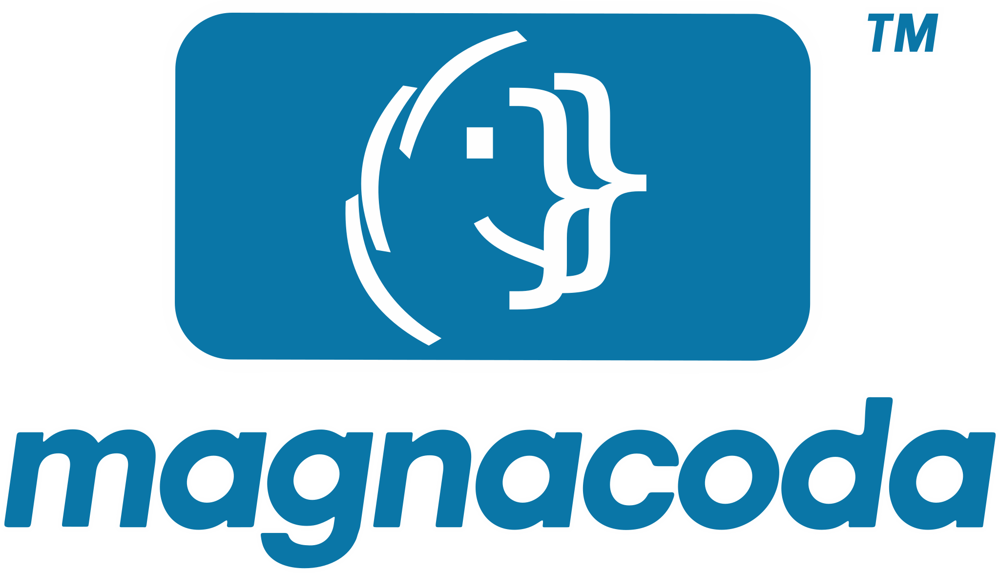

<p align="center">
<picture>
<source media="(prefers-color-scheme: dark)" srcset="images/magnacoda-DrkColorGH-Logo.svg">

</picture>
</p>
<p align="center">Scan for web accessibility issues.<br>Learn to fix them.</p>

# *magnacoda* manual

*magnacoda* is an accessibility scanner for WCAG, the Web Content Accessibility Guidelines, that you run from your terminal. It explains what it finds and suggests fixes, tests what automated rule checks can't by using the page itself, and shows every criterion that still needs a person.

This manual covers all of it. To install *magnacoda* and run your first scan, start with the [README](../README.md); in *magnacoda*, type `readme`.

**Contents**

- [Using *magnacoda*](#using-magnacoda)
  - [Starting *magnacoda*](#starting-magnacoda)
  - [Settings](#settings)
  - [Help viewer](#help-viewer)
- [Scan options](#scan-options)
  - [What to check](#what-to-check)
  - [AI reasoning](#ai-reasoning)
  - [Output and CI](#output-and-ci)
  - [Pages behind a login](#pages-behind-a-login)
  - [Pages that need help to load](#pages-that-need-help-to-load)
- [Advanced scan options](#advanced-scan-options)
- [What do the results show?](#what-do-the-results-show)
  - [Saving scans](#saving-scans)
  - [Reviewing and rechecking](#reviewing-and-rechecking)
  - [Fix suggestions](#fix-suggestions)
    - [Top-10 ranking](#top-10-ranking)
  - [What is left to check by hand](#what-is-left-to-check-by-hand)
  - [Beyond axe-core: testing the page as people use it](#beyond-axe-core-testing-the-page-as-people-use-it)
  - [A note on coverage](#a-note-on-coverage)
- [How do I choose what to scan?](#how-do-i-choose-what-to-scan)
  - [URL rules](#url-rules)
  - [Mobile and desktop](#mobile-and-desktop)
  - [Light and dark mode](#light-and-dark-mode)
- [How do I keep track?](#how-do-i-keep-track)
  - [History](#history)
  - [Favorites](#favorites)
  - [Updates and news](#updates-and-news)
- [AI and automation](#ai-and-automation)
  - [AI tiers](#ai-tiers)
    - [API key](#api-key)
    - [Two ways to run the AI tiers: an API key or your Claude subscription](#two-ways-to-run-the-ai-tiers-an-api-key-or-your-claude-subscription)
  - [How do I use it with CI, scripts and AI agents?](#how-do-i-use-it-with-ci-scripts-and-ai-agents)
    - [GitLab CI](#gitlab-ci)
    - [GitHub Actions](#github-actions)
    - [Scripts](#scripts)
    - [From an AI coding agent](#from-an-ai-coding-agent)
- [Related tools](#related-tools)

## Using *magnacoda*

How to start *magnacoda*, where it keeps its settings, and how to make the help viewer your own.

### Starting *magnacoda*

*magnacoda* runs in a terminal, the window where you type commands. To open one:

- **Windows:** open Start, type `Terminal` (on Windows 10, `PowerShell`) and press `Enter`.
- **macOS:** press `Cmd+Space`, type `Terminal` and press `Enter`. It's also in Applications, in the Utilities folder.
- **Linux:** press `Ctrl+Alt+T` (on Ubuntu and many others), or find Terminal in your app menu.

Then type one of these:

- `magnacoda` opens the shell, where you type commands without `magnacoda` in front.
- `magnacoda wizard` goes straight to the wizard.
- `magnacoda scan example.com` scans a page, then returns to the terminal.

If the terminal says it doesn't know the command, open a new terminal window, because a newly installed command is only found in windows opened after it was installed.

To open *magnacoda* without a terminal first, type `magnacoda shortcut` and choose your app menu, your desktop or both. On Windows the menu is the Start menu, where `Ctrl+Alt+M` opens it too; on macOS it's Applications, and the first time, macOS asks whether *magnacoda* may control Terminal. Uninstalling *magnacoda* leaves the shortcuts behind, so type `magnacoda shortcut remove` first. When you leave *magnacoda*, a shortcut's window stays open until you press `Enter`, so you can read the last lines at your own pace.

### Settings

*magnacoda*'s settings are in `preferences.ini`, in its settings folder: `~/.config/magnacoda/` on Linux and macOS (or under `$XDG_CONFIG_HOME` if that is set), `%APPDATA%\magnacoda\` on Windows. Each setting has a line saying what it does; edit them in any text editor.

- `[scan]`: asking before a scan, the time estimate, quick scans
- `[display]`: typing text out, tips, the spinner
- `[pager]`: the help viewer, for `help`, `readme`, `docs` and `view`
- `[review]`: a new tab or window for the review page
- `[history]`, `[news]` and `[ai]`: how many scans to remember, the daily check, how the AI tiers run

The other sections say which settings matter to them.

### Help viewer

`help`, `readme`, `docs` and `view FILE` all open in the help viewer, with its keys on the bottom rows; the README's [Help](../README.md#help) section lists the rest. Colors are turned off by the standard `NO_COLOR` environment variable.

To open a page this one mentions, such as `docs starting`, press `o`, type it and press `Enter`. For other commands, first press `q` or `Esc` to close the help viewer.

**Your own colors.** Add themes to `pager-colors.ini`, in the same folder as `preferences.ini`, and they appear under `c` after the built-in ones:

```ini
[slate]
description = pale yellow on slate blue
text = #ffe8a6
background = #293955
accent = #ffffff    ; optional: the title, headings, links and key bars
code = #34466a      ; optional: code's background
```

Colors are `#rrggbb`. The text and the accent need a contrast of at least 7:1 against the background, and the text against code; a theme that falls short is left out, and the list says why.

## Scan options

Every option for `scan`, with more than `help scan` has room for. Type them after the address: `scan example.com --screen both` in the shell, or `magnacoda scan example.com --screen both` from the command line. The rarely needed ones are in [Advanced scan options](#advanced-scan-options).

**With only an address, or none.** `scan` on its own asks for the address. `scan example.com` shows the default settings and asks before it starts. Press `Enter` to scan, or `n` to stop (to choose settings, type `wizard`). If you've scanned the page before, its saved settings come first: a favorite, then your last scan. `q`, `clear` or `Ctrl+C` cancels at any question. There's no question when you give an option, with `-y`, or in scripts and CI; to turn it off, set `confirm = off` under `[scan]` in `preferences.ini`.

The address can be short, such as `example.com` or `localhost:3000`; see [URL rules](#url-rules).

### What to check

- **`--level [A|AA|AAA]`**: the WCAG conformance level. Default: AA, the one most laws and organizations ask for.
- **`--wcag-version [2.0|2.1|2.2]`**: the WCAG version to test against. Default: 2.2. Some laws and contracts still name 2.1.
- **`--screen [desktop|mobile|both]`**: scan as a desktop (the default) or as a phone. Mobile uses a Pixel 8 Pro profile: small screen, touch, mobile user-agent. `both` scans desktop, then mobile, into one scan, marking problems found on only one; see [Mobile and desktop](#mobile-and-desktop). Dark mode is checked on every scan, in seconds; see [Light and dark mode](#light-and-dark-mode).
- **`--quick`, `--thorough`**: `--quick` leaves out the slowest tests that use the page (watching for moving content, hovering, clicking, single keys), about 10 seconds a scan, and the checklist leaves those checks to you. `--thorough` runs them. Default: the `quick` setting under `[scan]` in `preferences.ini` (off).

### AI reasoning

The AI tiers need your own Anthropic API key, or Claude Code logged in to your Claude subscription; see [AI tiers](#ai-tiers).

- **`--ai [off|explain|semantic]`**: `off`, no AI (axe-core and *magnacoda*'s own tests, with offline fix suggestions). `explain`, plain-language explanations and AI-written fixes for the top 10 findings. `semantic`, also a second AI pass for issues axe-core can't detect. Default: off.
- **`-y`, `--yes`**: accept the AI data-sharing question in advance, for scripts.

### Output and CI

Every scan is saved in its own folder in `magnacoda-scans`: the checklist (`checklist.md`), the results file (`results.json`) and the page's images; see [Saving scans](#saving-scans). A scan ends with a short summary; the findings are on the review page (`review`).

- **`--show-findings`**: also show the full findings in the terminal.
- **`-o`, `--output PATH`**: also write the full results as JSON to this file, for CI; an existing file is replaced. `-o -` prints the JSON, for a program to read.
- **`--fail-on [none|minor|moderate|serious|critical]`**: exit with code 1 if the scan finds a problem at or above this severity, so a CI build can fail on it. Errors (a page that won't load, a bad option) exit with code 2, and `Ctrl+C` with 130. Default: serious. See [How do I use it with CI, scripts and AI agents?](#how-do-i-use-it-with-ci-scripts-and-ai-agents)
- **`-v`, `--verbose`**: more detail; repeat for more.

Colors are turned off by the standard `NO_COLOR` environment variable.

### Pages behind a login

- **`--storage-state PATH`**: start from a saved Playwright login session (a storage-state JSON file).
- **`--cookie NAME=VALUE`**: set a cookie before loading the page. Repeat for several.
- **`--extra-http-header KEY=VALUE`**: send an extra HTTP header with every request. Repeat for several.

Cookie and header values are never stored. With either one, *magnacoda* doesn't fall back to `http://`, so they never cross the network unencrypted.

### Pages that need help to load

- **`--wait-for-selector TEXT`**: wait until this CSS selector appears before scanning, for apps that load their content late.
- **`--ignore-https-errors`**: continue past invalid or self-signed HTTPS certificates, for local development servers.

For a page that's just slow, see `--wait` in [Advanced scan options](#advanced-scan-options).

## Advanced scan options

These are rarely needed, so `help` lists them in a section of their own, but they work like the others.

- **`--wait SECONDS`**: give a slow page this much longer to load and to settle (both normally wait up to 30 seconds).
- **`--color-scheme [light|dark|both]`**: by default (`both`) the page is scanned in light mode, then dark mode is checked in seconds. `light` or `dark` scans that one theme only, fully; see [Light and dark mode](#light-and-dark-mode).
- **`--device TEXT`**: emulate one specific Playwright device by name, for example `iPhone 13`. Takes priority over `--screen`'s preset; can't be combined with `--screen both`.
- **`--viewport WIDTHxHEIGHT`**: the exact browser window size. Takes priority over the size of any device or `--screen` preset; can't be combined with `--screen both`. Desktop is 1280x720.
- **`--user-agent TEXT`**: send this User-Agent string.
- **`--browser [chromium|firefox|webkit]`**: which browser engine to use. Default: chromium. Where the CSS behind a problem is set is found only with Chromium.
- **`--headful`**: show the browser window instead of running it hidden.
- **`--include-best-practice`**: also check axe-core's best-practice rules, which aren't WCAG requirements.
- **`--ai-model TEXT`**: which Claude model the AI tiers use. Default: claude-sonnet-5.
- **`--ai-engine [auto|api|claude-code]`**: which account the AI tiers use: `api` (your Anthropic API key), `claude-code` (your Claude subscription, through Claude Code), or `auto` (the choice you made in setup). Your Claude plan is never used until you say yes. Default: auto. See [Two ways to run the AI tiers](#two-ways-to-run-the-ai-tiers-an-api-key-or-your-claude-subscription).
- **`--scans-dir PATH`**: save this scan in PATH instead of your scans folder.

## What do the results show?

A saved scan opens in your browser, where you can work through it and [recheck](#reviewing-and-rechecking) what you've fixed. The sections after that cover the fix suggestions, what still needs a person, and how much of WCAG a scan can cover.

### Saving scans

Every scan is saved in its own folder, named after the site and the time, inside `magnacoda-scans` in your Documents folder, wherever you start *magnacoda*:

```
magnacoda-scans/example.com_20261010-153012/
    checklist.md     the Markdown checklist
    results.json     everything the scan found, as JSON
    images/          screenshots of the page's images, shown in the checklist
```

A scan of both screens, and the dark-mode check, are part of the same checklist and results file. After a scan, *magnacoda* says briefly what it found, where it saved it, and what to type next; the full findings are on the review page (add `--show-findings` to see them in the terminal too). To save every scan somewhere else, set `folder =` under `[scan]` in preferences.ini; for one scan, add `--scans-dir PATH`. `-o FILE` writes a copy of the results at a name of your own, such as for CI.

**Screenshots of images.** A scan also photographs the page's images (up to 30), including SVG and canvas drawings, so you can compare each picture with its text alternative in the checklist. The screenshots stay on your computer and are never sent to the AI tiers.

When *magnacoda* creates the scans folder it also puts a `.gitignore` containing `*` inside it, so any git project ignores your saved scans without you editing its own `.gitignore` (a folder that already existed is left exactly as it was). Saved scans can include snippets and screenshots of the scanned pages, including pages behind a login if you scanned with `--cookie`, so keep them out of version control unless you mean to share them.

### Reviewing and rechecking

`review` lists the scans in your scans folder (or `review FOLDER` for another one), newest first, with how far along each checklist is. Pick one by number and it opens in your browser, in one tab:

- **The findings,** open at the start: what the scan found, counts by severity, the failing rules and where they are, the top 10 explained and the suggested fixes, with severity colors.
- **The checklist,** below them, with each page element's screenshot and a real checkbox to tick. Ticking saves straight into the scan's `checklist.md`, so the same ticks show up in a Markdown editor, and the other way round.
- **For a scan with several variants,** links at the top switch between them (Desktop · light, Mobile · dark and so on); each has its own ticks.

**Besides problems,** the review page also lists **Passed checks** (rules axe-core evaluated that found no violation, ordered by WCAG success criterion) and **Needs manual review** (what axe-core couldn't decide, with the element and the reason, such as text over a background image), and ends with how many rules did not apply. The results file has them too (`passed`, `needs_review`, `inapplicable_count`), and `--show-findings` prints them in the terminal.

Press the page's **Done** button when you've finished (or `Ctrl+C` in the terminal). Where there's no browser (over SSH, for example), or with `review --no-browser`, the checklist opens in the help viewer instead. There you can read it but not tick items; for that, use the review page or a Markdown editor (see Ticking items off, below).

**How the review page stays private:** it is served by a small web server that *magnacoda* runs on your own computer only while you review (Python's built-in one, so nothing extra is installed). It listens only on `127.0.0.1`, every address includes a new random secret, and requests from other websites are refused, so nothing else can read your scan or tick boxes in your files. The page itself passes *magnacoda*'s own scan at Level AAA, in light and dark.

**Rechecking your fixes.** Once you've fixed some problems, `recheck` (or the **Recheck fixes** button on the review page) tests just the scan's **Fix** items again, on the same page with the same settings, in a few seconds, so there's no need to wait for a whole new scan. The saved checklist is updated in place, with confirmed fixes ticked and problems still there unticked, each with a dated note, and it ends with a summary such as "4 of 6 problems fixed; 2 still fail." A recheck doesn't look for new problems, so scan the page again before release. Behind a login, it uses the scan's saved login file (`--storage-state`), or the `--cookie` or `--extra-http-header` you give it.

**Ticking items off** works in the review page or in any Markdown editor (Typora, VS Code, Obsidian and so on), since `checklist.md` is the record. A checklist also pastes straight into a GitLab or GitHub issue, where the boxes stay tickable. **A repeat scan keeps your work.** When you save a new scan of the same page, what a person had checked in the previous scan comes already ticked, marked with that scan's date, while problems found again start unticked.

### Fix suggestions

Every finding gets a fix suggestion. Without AI, they come from offline templates, one per rule, so every finding has one. With `--ai explain` or `--ai semantic`, the top 10 findings get context-specific, Claude-written corrected snippets instead, bundled into the same AI call at no extra cost; the rest keep the offline ones.

Findings that need the exact same fix (several elements sharing one CSS class, for example) are combined into one entry rather than repeated for each element.

**Where the CSS is set.** For problems a CSS property causes (a link's underline removed, a text color with too little contrast, the focus outline removed, text clipped by a fixed height, a small target), the checklist, the review page and the terminal also say which rule sets it, as the Styles panel of Chrome's DevTools would, for example "set by `.entry a { text-decoration: none }` in /css/site.css, line 12." When the stylesheet has a source map, as is usual on local development servers, it also names the file you edit ("from src/_links.scss, line 5, by its source map"). A rule in a `<style>` element, in the element's own `style` attribute, added by a script, or that is a single class on the element (perhaps a utility class, as in Tailwind) is named as such. This needs Chromium, the default browser; with Firefox the fixes are shown without it. The CSS found is saved with the scan, like the HTML snippets, and isn't sent to the AI tiers.

A rule without a template of its own gets axe-core's description of the rule and two places to read more: the rule's page at Deque University ("axe-core rule") and the W3C's Understanding page for each WCAG criterion it's about.

#### Top-10 ranking

The 10 findings that get explanations (and, with AI, fixes written for them) are picked in a fixed order:

1. Severity: `critical > serious > moderate > minor`
2. WCAG level: A before AA
3. How many elements it affects, most first
4. Where it first appears on the page, as the final tiebreak

Findings from the `semantic` tier carry a severity and level too, so they're ranked the same way as axe-core's.

### What is left to check by hand

Automated tests can settle only some WCAG success criteria. For every criterion in your chosen version and level, *magnacoda* works out what was automated and what still needs a person:

- **Terminal** (with `--show-findings`): a "Still to check manually: relevant to this page" table (with why it is relevant, the first two elements that made it relevant, and how to check it), plus counts for the rest.
- **The checklist** (`checklist.md` in the scan's folder): a Markdown checklist organized around the page. First, **Page elements**: each element with a problem or something to check, listed once, with everything about it underneath: **Fix** (failed a check, with the suggested fix; tick it when you've fixed it), **Review** (something axe-core couldn't decide) and **Check** (needs a person, with how to check). An element's Review and Check items share one box, **Checked**. Elements with exactly the same items are listed together, each with its own box, and an image with no text alternative asks whether it's purely decorative, with the change to make for either answer. Then, by criterion, everything that isn't about particular elements. Each criterion links to the W3C's Understanding page.
- **JSON**: the same data under `checklist` and `page_features`.

**Where to look:** each element is named by its CSS selector (how a developer finds it in the code) and a short hint a person recognizes on the page, such as `label:nth-of-type(2) > input` ("Password"). Radio buttons and checkboxes that share a name are one question, so they're listed once, as a group; a group whose question isn't named for screen readers is listed to **Fix** (WCAG 1.3.1).

"Relevant to this page" is decided from features found in the live DOM: audio/video and iframes (captions, audio description), forms and inputs (error handling, labels), password fields and CAPTCHAs (accessible authentication), fixed/sticky elements (focus not obscured), draggable items and custom widgets (dragging, gestures), tooltips/popups, animation, live regions, and more. A criterion whose trigger isn't found is listed as "probably not applicable" and is worth a quick confirmation, not a skip. The exception is audio and video. On a page with no audio, video or embedded player (`iframe`, `object`, `embed`), the criteria about them are listed as *not applicable to this page* and come ticked; untick one if the page shows media only after you click something. Site-level criteria (consistent navigation, multiple ways to find pages) can't be judged from one page and are listed separately.

### Beyond axe-core: testing the page as people use it

axe-core reads the page as it is. Many WCAG criteria are about what happens when someone uses it: where the keyboard focus goes and whether it can be seen, what a form does when it's sent, whether the page still works zoomed in. So after axe-core's checks, *magnacoda* uses the page itself, in the same browser. It presses `Tab` through it, lays it out again zoomed in and with wider text spacing, sends its forms empty and changes their fields, hovers, clicks and presses single keys. Each test reports problems as **Fix** items under the element, with the change to make, and notes what went right on the element's **Check** items.

A test tries what it can, not everything a criterion asks, so the third column says what happens when it finds nothing: whether the criterion then counts as passed (with a short follow-up for what's left), or still needs a person.

| WCAG criterion | What *magnacoda* tests | When it finds nothing |
| --- | --- | --- |
| 1.2.3, 1.2.5 Audio description | whether each video has an audio description track | a note for you |
| 1.3.1 Info and Relationships | radio buttons and checkboxes whose question has no name | axe-core's result stands |
| 1.3.5 Identify Input Purpose | fields that look like the visitor's own details but have no `autocomplete` value | notes for you |
| 1.4.4 Resize Text | the page at 200% zoom: text cut off | passed, with a follow-up |
| 1.4.10 Reflow | the page at 320 px wide: elements that make it scroll sideways | passed, with a follow-up |
| 1.4.12 Text Spacing | WCAG's text spacing: text cut off or spilling out | passed, with a follow-up |
| 1.4.13 Content on Hover or Focus | tooltips and menus that vanish, can't be hovered, or don't close with `Esc` | still needs a person |
| 2.1.1 Keyboard | controls only the mouse can use; custom controls `Enter` and `Space` don't work | still needs a person |
| 2.1.2 No Keyboard Trap | `Tab` getting stuck | passed, with a follow-up |
| 2.1.4 Character Key Shortcuts | single keys that do something with nothing focused | a note for you |
| 2.2.1 Timing Adjustable | a page that moves on to another by itself after a delay (a timed redirect) | still needs a person |
| 2.2.2 Pause, Stop, Hide | content moving by itself with no pause button | still needs a person |
| 2.4.1 Bypass Blocks | whether the skip link moves the focus | passed, if axe-core agrees |
| 2.4.3 Focus Order | where the focus jumps back up the page, and elements you can't see that `Tab` still reaches (such as a hidden spam-trap field) | a note for you |
| 2.4.7 Focus Visible | focus that can't be seen | passed, with a follow-up |
| 2.4.11 Focus Not Obscured | focus hidden under a banner or sticky header | passed, with a follow-up |
| 3.2.1 On Focus | getting the focus alone loading a page, opening a window or moving the focus | passed, with a follow-up |
| 3.2.2 On Input | changing a field doing the same | passed, with a follow-up |
| 3.3.1 Error Identification | forms sent empty: error text missing, or not tied to its field | notes for you |
| 3.3.3 Error Suggestion | the error messages, shown for you to judge | notes for you |
| 3.3.8 Accessible Authentication | password fields that refuse pasting, or turn password managers away | notes for you |
| 4.1.2 Name, Role, Value | expand and collapse buttons whose `aria-expanded` is missing or wrong | still needs a person |
| 4.1.3 Status Messages | error messages screen readers aren't told about | notes for you |

**Limits.** The tests try typical use rather than everything. They don't fill in forms with real data, explore menus and dialogs once they're open, or see checks that happen on the server. A clean result means none of these problems were seen, so each criterion's follow-up says what's left for you.

**Nothing is sent, and nothing changes on the site.** While the page is tried, every request it makes is blocked, so a form that sends itself is noticed without being sent. The page changes only in your browser, after axe-core's checks.

**Quick scans.** Watching for moving content, hovering, clicking and pressing single keys add about 10 seconds a scan. `--quick` leaves them out, and the checklist then leaves those checks to you.

### A note on coverage

Automated testing settles some WCAG criteria well: whether an image has alt text, whether text meets a contrast ratio, whether a form field has a label. axe-core checks these, and *magnacoda*'s own tests add what shows up when the page is used, such as focus you can't see, keyboard traps, or sideways scrolling when zoomed in (see [Beyond axe-core](#beyond-axe-core-testing-the-page-as-people-use-it)).

Other criteria are about meaning, and those need a person. A tool can see that alt text exists, but not whether it describes the image. It can trace where the focus goes, but not whether that order makes sense, and it can collect the error messages, but not judge whether they help. That's why accessibility audits combine automated testing with manual review, and why conformance is judged by people.

So each checklist covers every criterion in scope (55 at WCAG 2.2 Level AA; 31 at Level A, 86 at AAA) and marks each one as failed, passed, or still needing a person. Those that need a person are sorted by where to start: relevant to this page (from features *magnacoda* detected), check on every page, depends on your site or user flows, and probably not applicable.

For example, in one scan of a small site's home page (WCAG 2.2 Level AA, desktop, light), 24 of the 55 criteria were checked automatically, 8 of them by *magnacoda*'s own tests (`Tab`, the layout zoomed in, the form fields). 1 failed (text contrast), 19 passed and 4 had nothing to check, each with a note on what to look at by hand, since passing an automated check rarely settles a criterion completely. 6 about audio and video didn't apply, as the page has none. The other 25 were left for a person, sorted into 7 relevant to this page, 7 to check on every page, 7 that depend on the site, and 4 probably not applicable.

**Ways to cover more:**

- **Use `--ai semantic`** for a second look at things axe-core can't judge: whether alt text is meaningful, whether the heading outline makes sense, and whether link text is clear out of context. It sends a bounded extract of the page to Claude (see [AI tiers](#ai-tiers)).
- **Scan more than one page.** A scan covers one page, and other page types (forms, checkout, article pages) can fail in different ways.
- **Work through the checklist's "Check first" items** with a keyboard and a screen reader. That's where expertise matters most, and where the most important remaining problems are usually found.

## How do I choose what to scan?

A scan can test a page on a desktop screen and a phone, in light and dark mode. These sections show how to type the address and how to pick what a scan covers.

### URL rules

What you type as the page to scan can be short, since *magnacoda* fills in `https://` or `http://` and always says which address it scans ("Scanning https://example.com"). History and saved scans keep the full address.

| You type | *magnacoda* scans |
|---|---|
| `https://example.com`, `http://example.com`, `file:///path/page.html` | exactly what you typed (`file://` scans a file on your computer) |
| `example.com`, `example.com/about` | `https://example.com...`; if that can't connect, `http://` once, as browsers do |
| `localhost:3000`, `127.0.0.1:8080`, `192.168.1.20`, `mysite.test` | `http://...`: local addresses, including names ending in `.localhost`, `.local` or `.test` |
| `mysite` (a one-word name, such as one in your hosts file) | `http://mysite`, if a computer by that name is found |
| `mysite:8080` | `http://mysite:8080`: a one-word name with a port is always an address |

- **No http fallback with login details:** with `--cookie` or `--extra-http-header`, *magnacoda* doesn't fall back to `http://`, because those would then cross the network unencrypted. It doesn't fall back when you typed `https://` yourself either.
- **A redirect to another site:** if an address sends the browser on to another site, *magnacoda* asks first whether to scan that one; in CI and scripts it scans where the page leads, and says so.

### Mobile and desktop

Responsive sites often change what they show on a phone (a collapsed menu, different images, touch-sized controls), so problems can exist on only one. `--screen both` tests the page on a desktop screen and on a phone, in one scan. The [guided wizard](../README.md#guided-wizard) does this unless you choose otherwise:

```bash
magnacoda scan https://example.com --screen both
magnacoda scan https://example.com --screen mobile
```

`mobile` uses a Pixel 8 Pro profile (small screen, touch, mobile user-agent); `desktop` is a 1280x720 window, and what a scan does without `--screen`. With `both`, each screen is scanned fully, so it takes about twice as long. The checklist and review page list each problem once, and one found on only one screen is marked "only on mobile" or "only on desktop," and the summary counts them. There is one checklist, one results file and one review page for the whole scan, and a recheck tests each fix on the screen where the problem was found. With `--ai` the consent prompt appears once, but the API calls (and cost) are doubled.

You rarely need an exact screen size, but if you do, `--viewport WIDTHxHEIGHT` and `--device "iPhone 13"` are still there. An explicit `--viewport` or `--device` takes priority over the `--screen` preset (`--screen mobile --viewport 500x900` is a phone profile in a 500x900 window), and `--screen both` refuses to be combined with them, since they pin one specific screen.

### Light and dark mode

Contrast problems often exist in only one theme, so every scan checks dark mode too. After scanning the page in light mode, *magnacoda* loads it again with the browser set to dark mode (`prefers-color-scheme: dark`) and compares its colors:

- **Nothing changed** (the page has no dark theme, or is always dark): there's nothing more to check, and the scan says "the page looks the same in dark mode."
- **It changed:** *magnacoda* tests what dark mode can change: contrast, images (sites often swap a logo or icons for dark mode) and whether the keyboard focus can be seen. That takes seconds rather than a second scan, because the rest (the keyboard, the layout, forms, hovering) doesn't depend on colors. Problems found in one theme only are marked "only in dark mode" or "only in light mode." Those found only in dark mode get offline fix suggestions; the AI tiers explain the light scan's.

To scan one theme only, and fully, use `--color-scheme light` or `--color-scheme dark` (`both`, the default, is what's described above).

Night modes such as Night Light or Night Shift only tint the screen. Websites can't see them, so there's nothing to test.

Sites that only switch themes with a button on the page (no `prefers-color-scheme` CSS) look the same to *magnacoda* in dark mode. If the button saves its choice to `localStorage`, capture a Playwright storage state with the dark theme selected and scan it with `--color-scheme dark --storage-state FILE`.

## How do I keep track?

*magnacoda* remembers your recent scans, keeps the ones you run often as [favorites](#favorites), and lets you know when there's a new version or news.

### History

*magnacoda* remembers your recent scans in a Markdown file that you can also read and edit by hand. It is created the first time the wizard starts (or a scan runs), in the same per-user folder as your saved API key: `~/.config/magnacoda/` on Linux and macOS (or under `$XDG_CONFIG_HOME` if that is set), and `%APPDATA%\magnacoda\` on Windows.

- **`history.md`**: every scan that actually runs, whether from the wizard, the shell or the command line, newest first. The oldest entries are dropped beyond the limit.

In the wizard, type `recent` to run one of them again. And when you scan an address you've scanned before, *magnacoda* offers its saved settings first: a favorite, then your last scan.

The values of `--cookie` and `--extra-http-header` are never stored. The history holds the URLs you scan, so on Linux and macOS it's readable only by you. See [SECURITY.md](../SECURITY.md).

### Favorites

Save the scans you run often, and start them again from the wizard. At the end of the wizard, answer yes to "Save this as a favorite?" and give it a name. At the start of the wizard, type `fav` to list them by name, then pick one to run it again, or to change just the URL. If you change its settings, *magnacoda* offers to update the favorite.

- **`favorites`** lists them, numbered, with their commands. Type a number to run one, or `help` for more. **`favorites delete NUMBER`** deletes one after asking (you can give its name instead, in quotes if it has spaces; add `--yes` to skip the question). `fav` and `favs` are short forms, as in `fav delete 2`.
- They are kept in **`favorites.md`**, next to `history.md`, and you can edit that file by hand.

### Updates and news

Once a day, when you use *magnacoda* in a terminal, it quietly checks two places in the background: **pypi.org**, for a newer version of *magnacoda* (and of any add-ons published there), and **news.magnacoda.dev**, for news about *magnacoda*, such as a new feature or a known problem. If there's something new, the shell's banner says so in one line, in place of the tip, in your first shell of the day for up to three days. `news` shows it in full, together with what's new in the version you have. `update` installs a newer version for you.

**What is sent:** only an ordinary web request for a public file, the same as visiting the page in a browser (which shows your IP address to the site, as any connection does), naming your version of *magnacoda* (for example `magnacoda/1.2.0`). Nothing about you, your scans or the pages you scan is sent, and there's no tracking, with no ID and no cookies. Private add-ons are never looked up.

**What is counted:** how many times news.magnacoda.dev is checked each day, and from which versions. Each copy of *magnacoda* checks at most once a day, so that's roughly how many people use it that day, and how quickly they move to a new version. Only those daily totals are kept, not IP addresses. Turning the check off (below) leaves you out of the count.

**What you'll notice:** nothing, unless there's news. The check never delays the shell; if there's no connection, or a site doesn't answer, it silently tries again the next day. The daily check never runs in CI, in scripts, or when output is redirected (`news` and `update` check when you run them yourself, except in CI), and news never appears in saved scans.

**Turning it off:** set `check = off` under `[news]` in `preferences.ini` (see [Settings](#settings)), or set the environment variable `MAGNACODA_NEWS=off`. `news` then shows only the notes that came with your version, and `update` still checks when you run it, since you asked.

**How `update` works:** it shows the versions it found and the exact commands it will run, and asks first. If you installed *magnacoda* with uv, pipx, or pip in a virtual environment, it runs them, then closes *magnacoda* so you can start the new version. On Windows, a running program can't replace itself, so the update opens in a new window and starts once *magnacoda* has closed. For any other kind of install, it shows the command to run yourself.

## AI and automation

AI is optional and off until you turn it on; [AI tiers](#ai-tiers) explains what each level adds. The rest is for running *magnacoda* with no one at the keyboard: in a CI pipeline, a script or an AI coding agent.

### AI tiers

| `--ai` | What it does | What leaves your machine |
|---|---|---|
| `off` (default) | axe-core and *magnacoda*'s own tests, no AI | nothing beyond the page fetch itself |
| `explain` | + plain-language "why it matters / how to fix" for the top 10 findings | rule id, WCAG criterion, selector and a shortened HTML snippet, for the top 10 only |
| `semantic` | + a second Claude pass over axe-blind categories (alt-text quality, reading order, link text out of context, heading structure) | the above, plus a limited extract of the page: images' alt text and file names and whether each shows, the heading outline, and link text and context, with which links go to the same place (not their addresses). Never the full page HTML or a screenshot |

Every AI-sourced finding is tagged `source: "claude-semantic"` (rather than `"axe-core"`), so you can filter the AI's judgment calls out entirely in CI, for example with `jq 'select(.source=="axe-core")'` on the results file.

The AI tiers are off unless you ask for them, and *magnacoda* asks for your consent before sending anything (in a script, `-y` or `--yes` gives it in advance). Without AI, no AI libraries are needed, and with `--ai=off` nothing about your scans leaves your machine. The only other connections *magnacoda* makes are a once-a-day check for updates and news, which sends nothing about you or your scans and can be turned off; see [Updates and news](#updates-and-news).

#### API key

*magnacoda* looks for your Anthropic API key in `$ANTHROPIC_API_KEY` first, then falls back to a key saved via `magnacoda setup` (which prompts for one, hidden and never echoed, and saves it to a per-user settings file outside the project folder; see [SECURITY.md](../SECURITY.md#api-keys) for the exact path and permissions). Remove a saved key with `magnacoda setup --forget-key`. If a key stops working (expired, revoked), a scan that hits that error offers to let you paste in a replacement on the spot instead of failing outright.

#### Two ways to run the AI tiers: an API key or your Claude subscription

`--ai-engine` chooses how the AI calls are made:

- **`api`: an Anthropic API key**, as described above. Billed by the API per use.
- **`claude-code`: your Claude Code login**, so a Claude subscription (such as Pro or Max) can be used instead of a key. *magnacoda* runs Claude Code's official headless mode (`claude -p`) in the background, with no tools, no saved session and your own Claude Code hooks switched off, from an empty temporary folder, so it reads and writes nothing outside that call. You need Claude Code installed and logged in once. To log in, open a normal terminal window (not the *magnacoda* shell), type `claude` to start Claude Code, then type `/login` there and follow the steps. Usage counts toward your Claude plan's limits instead of an API bill. Each call also carries about 13,000 to 16,000 tokens of Claude Code's own setup; `explain` makes one call per scan and `semantic` two, times the number of scans (`--screen both`, `--color-scheme both`).
- **`auto`** (the default): the choice you made. When Claude Code is installed, `magnacoda setup` asks "Use your Claude plan for the AI tiers? [Y/n]" and saves the answer as `engine = claude-plan` or `engine = api-key` under `[ai]` in `preferences.ini` (run setup again, or edit that line, to change it). If you haven't chosen yet, the first AI scan asks the same question once. Your Claude plan is never used until you say yes. So without a choice, and with nobody there to answer (a script or CI), *magnacoda* uses an API key if there is one, and otherwise stops and says how to choose.

**What differs for your data:** the same bounded data is sent either way (see the table above), but with `claude-code` your Claude plan's terms and data settings apply, which can differ from the API's (for example, whether conversations may be used to improve Claude). The consent prompt says which applies before anything is sent.

**Platforms:** tested on Linux; macOS and Windows are designed for but not yet tested. Using a subscription this way is intended for your own scans; for heavy automated use such as CI, check Anthropic's current terms, or use an API key.

### How do I use it with CI, scripts and AI agents?

The shell and the wizard are for people. For everything else, *magnacoda* is a single command. Every choice is an option on the command line, it never stops to ask a question when nobody is there to answer, and its exit code says how the scan went. That's what lets it run in a CI pipeline, from a script, or from an AI coding agent.

```bash
magnacoda scan https://staging.example.com --fail-on serious --scans-dir magnacoda-scans -o accessibility.json
```

- **Every scan is saved** in its own folder: the checklist, `results.json` and screenshots of the page's images. `--scans-dir magnacoda-scans` puts them in the project folder instead of the machine's Documents. Keep that folder as a build artifact to look at a failed run later (copy it to your computer and type `review FOLDER`).
- **`-o FILE`** also writes the results to a file name of your choosing, since each scan folder is named after the site and the time; an existing file is replaced. `-o -` prints the JSON instead, for another program to read (the short summary goes to standard error, so it doesn't mix in).
- **`--fail-on`** sets which problems fail the run (`critical`, `serious`, the default, `moderate`, `minor`, or `none`). The exit codes: 0 when nothing at or above `--fail-on` was found, 1 when something was, and 2 when the scan couldn't finish, such as a page that couldn't be loaded (it always says why: "Error: ..."). When the output isn't a terminal, as in a script or CI log, a last line also explains the code, such as "Exit code 1: 2 problems at or above serious." An unexpected error also exits with 2; run the scan again with `-v` for the details. `--fail-on none` always exits 0 after a scan. `Ctrl+C` stops a scan at any point, saves nothing and exits with 130; in the shell it says "Cancelled." and returns to the prompt.
- **`--show-findings`** prints the full findings into the log, besides the short summary.
- **`--quick`** leaves out the slowest tests that use the page, for about 10 seconds a scan.
- **Nothing else happens:** no question is asked, the daily check for updates and news never runs in CI or when output isn't a terminal, and nothing is sent to an AI unless you add `--ai` (then also `-y`, to accept the consent question in advance, and an `ANTHROPIC_API_KEY`).

Every option is in [Scan options](#scan-options) and [Advanced scan options](#advanced-scan-options), and listed briefly in `help scan` and `help advanced`. An option *magnacoda* doesn't have gets a one-line error, and the run exits with code 2.

#### GitLab CI

```yaml
accessibility:
  stage: test
  image: python:3.12
  script:
    - pip install magnacoda
    - python -m playwright install --with-deps chromium
    - magnacoda scan https://staging.example.com --fail-on serious --scans-dir magnacoda-scans -o accessibility.json
  artifacts:
    when: always
    paths:
      - magnacoda-scans/
      - accessibility.json
```

#### GitHub Actions

```yaml
name: Accessibility
on: [push, pull_request]

jobs:
  scan:
    runs-on: ubuntu-latest
    steps:
      - uses: actions/setup-python@v7
        with:
          python-version: "3.12"
      - run: pip install magnacoda
      - run: python -m playwright install --with-deps chromium
      - run: magnacoda scan https://staging.example.com --fail-on serious --scans-dir magnacoda-scans -o accessibility.json
      - uses: actions/upload-artifact@v7
        if: always()
        with:
          name: accessibility
          path: |
            magnacoda-scans/
            accessibility.json
```

Notes for both:

- **The browser:** `python -m playwright install --with-deps chromium` installs Chromium and the system libraries it needs on Linux. That needs administrator rights, which CI jobs have (Playwright uses `sudo` when the job doesn't run as root). On your own computer, `magnacoda setup` downloads the browser instead.
- **Scanning the site the job builds:** start it in the background, then scan its local address, such as `npx serve dist -l 8080 &` and then `magnacoda scan localhost:8080 --fail-on serious`.
- **Several pages:** one `magnacoda` line per page, each with `--scans-dir magnacoda-scans`; each gets its own folder there.
- **Pages behind a login:** see [Pages behind a login](#pages-behind-a-login); keep the values in your CI system's secret variables.

#### Scripts

A scan from a script works the same way. For example, a quick look at a few pages, carrying on whatever each finds:

```bash
for page in / /about /contact; do
  magnacoda scan "https://example.com$page" --quick --fail-on none
done
```

Each scan is saved, so `review` then lists them all, and `recheck` tests the fixes in any of them again.

#### From an AI coding agent

AI coding agents (such as Claude Code, Cursor or GitHub Copilot's agent) run command-line tools to check their own work. An agent that has just changed a page can scan it and read what was found:

```bash
magnacoda scan localhost:3000 --quick --fail-on none -o -
```

This prints the results as JSON. The parts an agent needs most:

- `findings`: each problem, with `rule_id`, `wcag_criteria`, `severity`, `selector`, `html_snippet`, a suggested `fix` (its `summary`), and, for problems a style causes, `css`: the rule, file and line that set it.
- `checklist`: every WCAG criterion in scope, with its `status` (failed, passed, still to check by a person, and so on).
- `needs_review`: what axe-core couldn't decide.

The saved `checklist.md` is just as useful. It's written for people, so an agent can read it too, and it says what still needs a person. To have an agent check its work as a habit, add a line such as this to its instructions file (`CLAUDE.md`, `AGENTS.md` or similar): *After changing a page, run `magnacoda scan localhost:3000 --quick --fail-on none -o -` and fix what it finds.*

## Related tools

*As of October 2026; these tools change quickly, and corrections are welcome. Product names are trademarks of their owners, and magnacoda isn't affiliated with any of them.*

Many good tools test accessibility. Here is how *magnacoda* relates to the best-known ones and to its closest neighbors.

**Open source**

- **[axe-core](https://github.com/dequelabs/axe-core) and [`@axe-core/cli`](https://github.com/dequelabs/axe-core-npm/tree/develop/packages/cli)** (Deque): the rule engine *magnacoda* itself runs, and Deque's command line for running it on web pages. *magnacoda* builds on axe-core, adding explanations and fixes, a checklist of every criterion, and tests that use the page.
- **[Pa11y](https://github.com/pa11y/pa11y)**: a mature command-line tool and Node library that runs HTML_CodeSniffer (its default) or axe-core, and can click, fill in fields or log in before testing. *magnacoda* adds explanations and fix suggestions, a checklist of every criterion, and tests that use the page, such as `Tab`, zooming in and sending forms.
- **[Lighthouse](https://developer.chrome.com/docs/lighthouse/accessibility/scoring)** (Google): Chrome's auditing tool, whose accessibility score comes from axe-core, with a list of checks to do by hand. *magnacoda* is about accessibility only, and goes into each problem and what's left.
- **[Accessibility Insights for Web](https://accessibilityinsights.io/docs/web/overview/)** (Microsoft): a Chrome and Edge extension with automated checks, a "Tab stops" helper that combines a visual guide with partial automation, and a step-by-step assessment against WCAG 2.1 AA. It suits a person working through a page by hand; *magnacoda* runs its keyboard tests by itself, from the command line, in scripts and CI too.
- **[IBM Equal Access Accessibility Checker](https://github.com/IBMa/equal-access)**: browser extensions and a Node package with IBM's own rule engine, for testing in the browser and in CI.
- **[Ally](https://github.com/Andersseen/ally)**: a young Node project that runs five rule engines (axe-core, IBM Equal Access, Siteimprove Alfa, QualWeb and HTML_CodeSniffer), scores the combined findings, and presses `Tab` and `Shift+Tab` to find keyboard problems, with optional AI-assisted review. It's the closest neighbor. *magnacoda* runs one engine, but tests more by using the page (zooming in, sending forms, hovering, clicking), and adds explanations, fixes, a checklist of every criterion and rechecks.
- **[Curbcut](https://github.com/JagheterAlex/curbcut)**: a Node command-line tool built on axe-core that maps findings to EN 301 549 for the European Accessibility Act, with baselines, PDF reports and accessibility statement drafts. It's built for compliance documents; *magnacoda* for understanding and fixing.

**Commercial platforms**

These are paid or freemium platforms for organizations: monitoring whole sites, dashboards and team workflows, support, and more and more AI. *magnacoda* is free, runs on your own computer, and suits one developer or content manager checking a page before committing or publishing it, so it can complement such a platform rather than replace it.

- **[axe DevTools](https://www.deque.com/axe/devtools/)** (Deque): a browser extension, linter and CI tools built on axe-core, with paid Intelligent Guided Tests that ask a person simple questions to test keyboard use, forms, modal dialogs, images, tables, structure and interactive elements, and AI features.
- **[Evinced](https://www.evinced.com/)**: flow analyzers for web and mobile, SDKs and a site scanner, using AI that, in its words, sees "each screen the way a sighted human would."
- **[TestParty](https://testparty.ai/)**: an AI platform that scans websites and proposes fixes in their source code, with monitoring, including for online shops such as Shopify stores.
- **[Level Access](https://www.levelaccess.com/)**: an enterprise platform combining automated scanning, evaluation by experts, AI-powered remediation, monitoring, training and VPAT/ACR documentation.
- **[Siteimprove](https://www.siteimprove.com/accessibility/)**: continuous monitoring across whole websites and documents, with a browser extension and AI to prioritize issues.
- **[BrowserStack Accessibility Testing](https://www.browserstack.com/accessibility-testing)**: workflow and site scans, CI integration, and screen readers on real devices, with free and paid plans.
